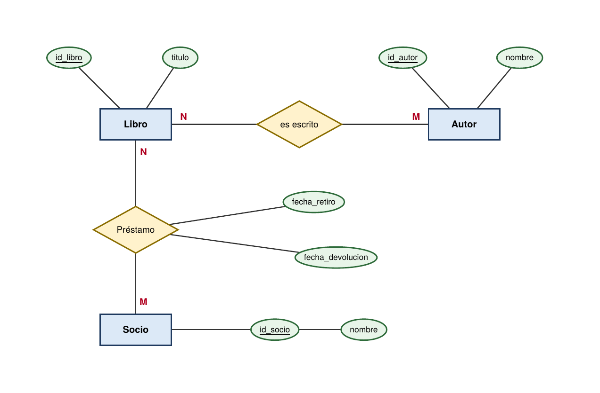
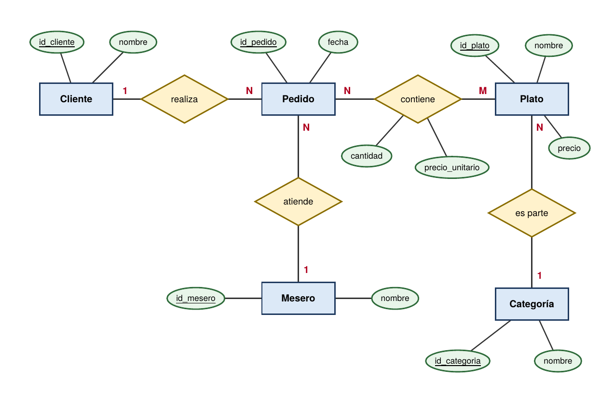
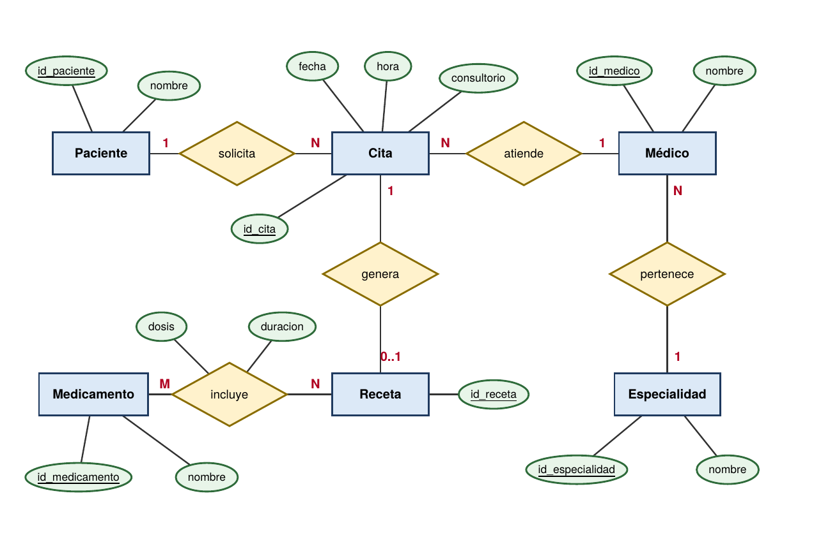
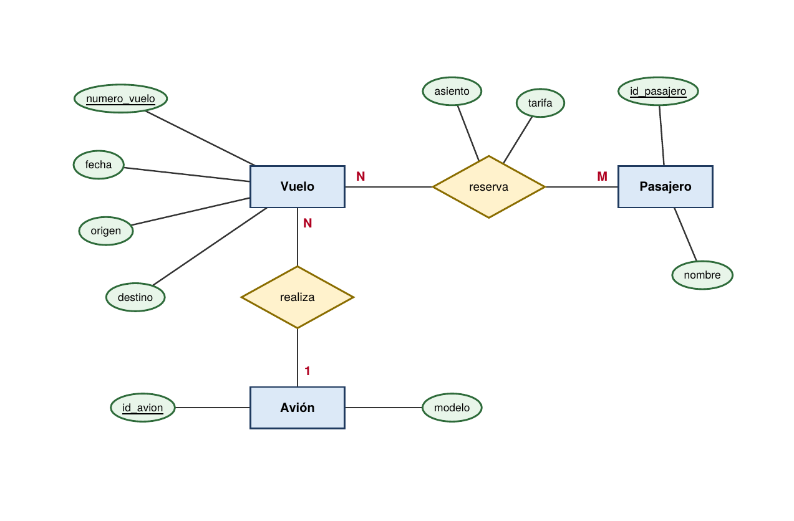
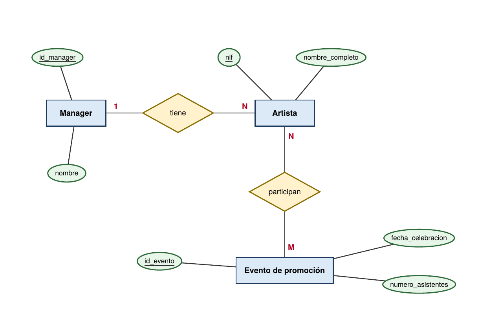
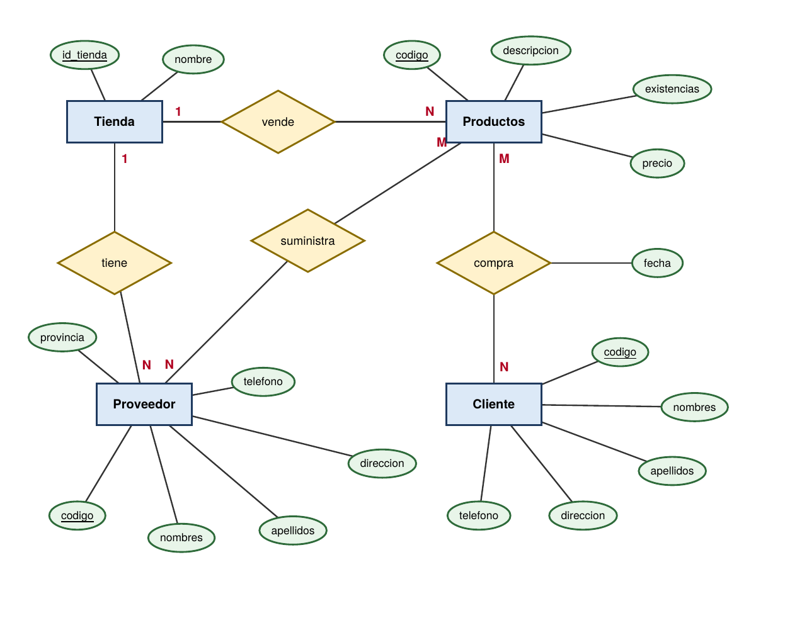
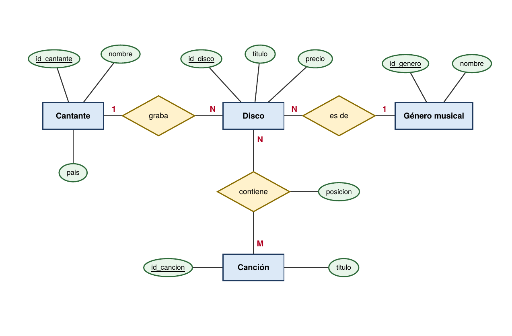
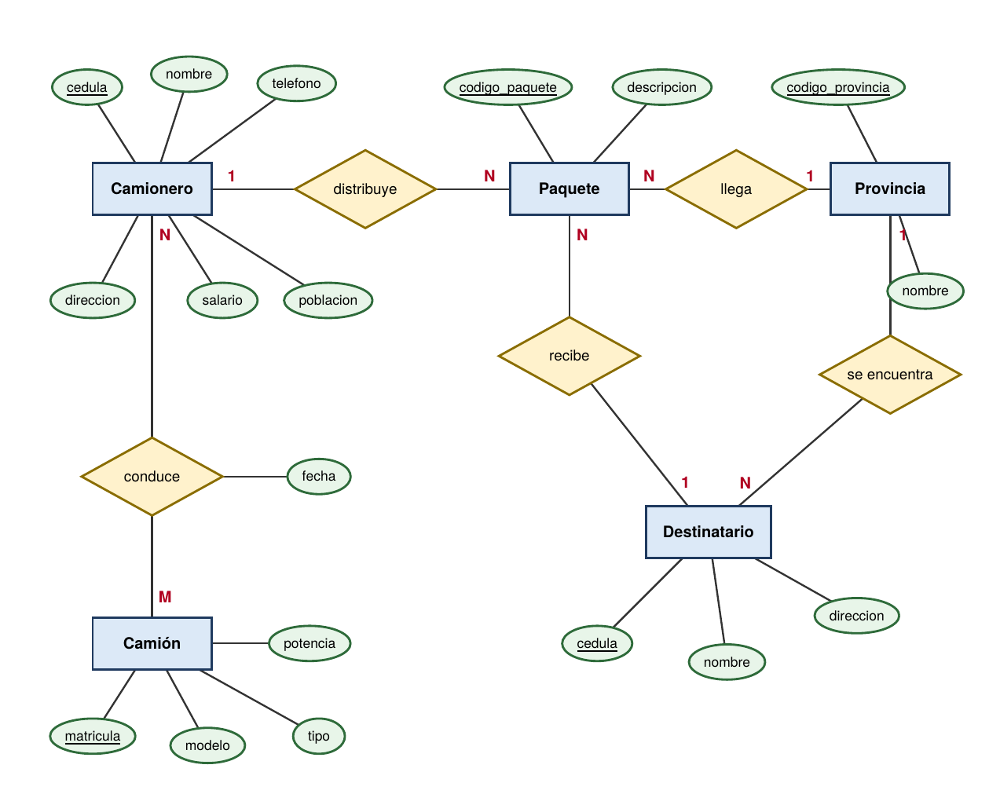
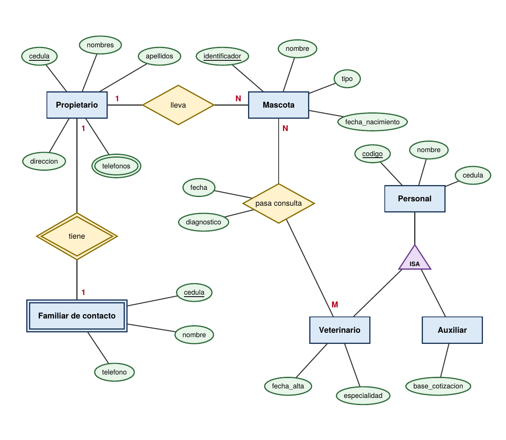

# Trabajo Autónomo - Base de Datos
### Modelado Entidad-Relación y código MySQL

Colección de 9 ejercicios de modelado de bases de datos: cada uno incluye su **diagrama Entidad-Relación** (notación de Chen) y el **script MySQL** del modelo relacional resultante.

## Información general

| | |
|---|---|
| **Facultad** | FEIRNNET |
| **Carrera** | Computación |
| **Ciclo / paralelo** | Ciclo 3-A |
| **Periodo académico** | Septiembre 2026 - Marzo 2027 |
| **Materia** | Base de datos |
| **Docente** | Rene Guaman |
| **Estudiante** | Christopher Alexander Pineda Rodas |

## Contenido

| N.º | Ejercicio | Base de datos | Diagrama | Script |
|:-:|---|---|:-:|:-:|
| 1 | Sistema de Biblioteca | `biblioteca` | [Diagrama](diagramas/ej01_biblioteca.png) | [SQL](sql/ej01_biblioteca.sql) |
| 2 | Pedidos de Restaurante | `restaurante` | [Diagrama](diagramas/ej02_restaurante.png) | [SQL](sql/ej02_restaurante.sql) |
| 3 | Clínica Médica | `clinica` | [Diagrama](diagramas/ej03_clinica.png) | [SQL](sql/ej03_clinica.sql) |
| 4 | Sistema de Aerolínea | `aerolinea` | [Diagrama](diagramas/ej04_aerolinea.png) | [SQL](sql/ej04_aerolinea.sql) |
| 5 | Empresa Discográfica | `discografica` | [Diagrama](diagramas/ej05_discografica.png) | [SQL](sql/ej05_discografica.sql) |
| 6 | Tienda Informática | `tienda_informatica` | [Diagrama](diagramas/ej06_tienda_informatica.png) | [SQL](sql/ej06_tienda_informatica.sql) |
| 7 | Discos Musicales | `discos_musicales` | [Diagrama](diagramas/ej07_discos_musicales.png) | [SQL](sql/ej07_discos_musicales.sql) |
| 8 | Camiones | `transporte` | [Diagrama](diagramas/ej08_camiones.png) | [SQL](sql/ej08_camiones.sql) |
| 9 | Veterinaria | `veterinaria` | [Diagrama](diagramas/ej09_veterinaria.png) | [SQL](sql/ej09_veterinaria.sql) |

## Estructura del repositorio

```
TrabajoAutonomoBaseDeDatos/
├── README.md
├── diagramas/        # Imagen PNG del diagrama E-R de cada ejercicio
├── sql/              # Un script .sql por ejercicio + todos_los_ejercicios.sql
└── docs/             # Informe en PDF con enunciados, diagramas y código
```

## Cómo ejecutar los scripts

Requisitos: **MySQL 8.0.16 o superior** (desde esta versión se aplican las restricciones `CHECK`).

Un ejercicio concreto:

```bash
mysql -u root -p < sql/ej01_biblioteca.sql
```

Todos los ejercicios a la vez (cada uno crea su propia base de datos):

```bash
mysql -u root -p < sql/todos_los_ejercicios.sql
```

Para comprobar el resultado:

```sql
SHOW DATABASES;
USE biblioteca;
SHOW TABLES;
```

## Notación de los diagramas

- **Rectángulo**: entidad (doble borde = entidad débil).
- **Rombo**: relación (doble rombo = relación identificadora).
- **Óvalo**: atributo (subrayado = clave primaria; doble óvalo = atributo multivaluado).
- **1, N, M**: cardinalidad de cada extremo de la relación.
- **Triángulo ISA**: jerarquía de especialización (Ejercicio 9).

## Criterios de transformación a MySQL

- Cada entidad se convierte en una tabla con su clave primaria.
- Las relaciones **1:N** se resuelven con una clave foránea en el lado N.
- Las relaciones **N:M** se resuelven con una tabla intermedia, que guarda los atributos de la relación (por ejemplo `cantidad` y `precio_unitario` en `detalle_pedido`).
- Los atributos multivaluados pasan a una tabla propia (`propietario_telefono`).
- La entidad débil `familiar_contacto` usa como clave la del propietario, con `ON DELETE CASCADE`.
- La jerarquía ISA (`personal`, `veterinario`, `auxiliar`) comparte el código como clave primaria y foránea.

## Diagramas

### Ejemplo 1: Sistema de Biblioteca



[Ver código MySQL](sql/ej01_biblioteca.sql)

### Ejemplo 2: Pedidos de Restaurante



[Ver código MySQL](sql/ej02_restaurante.sql)

### Ejemplo 3: Clínica Médica



[Ver código MySQL](sql/ej03_clinica.sql)

### Ejemplo 4: Sistema de Aerolínea



[Ver código MySQL](sql/ej04_aerolinea.sql)

### Ejercicio 5: Empresa Discográfica



[Ver código MySQL](sql/ej05_discografica.sql)

### Ejercicio 6: Tienda Informática



[Ver código MySQL](sql/ej06_tienda_informatica.sql)

### Ejercicio 7: Discos Musicales



[Ver código MySQL](sql/ej07_discos_musicales.sql)

### Ejercicio 8: Camiones



[Ver código MySQL](sql/ej08_camiones.sql)

### Ejercicio 9: Veterinaria



[Ver código MySQL](sql/ej09_veterinaria.sql)

---

Christopher Alexander Pineda Rodas
